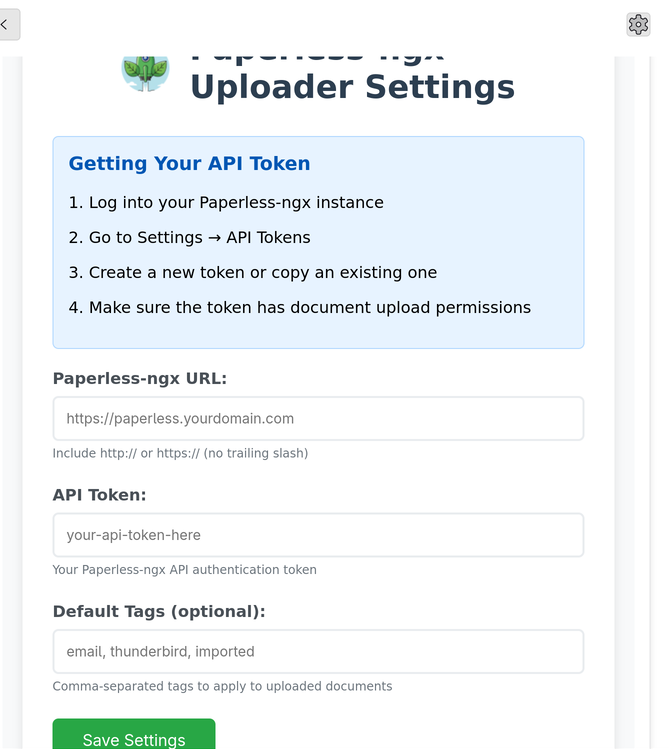
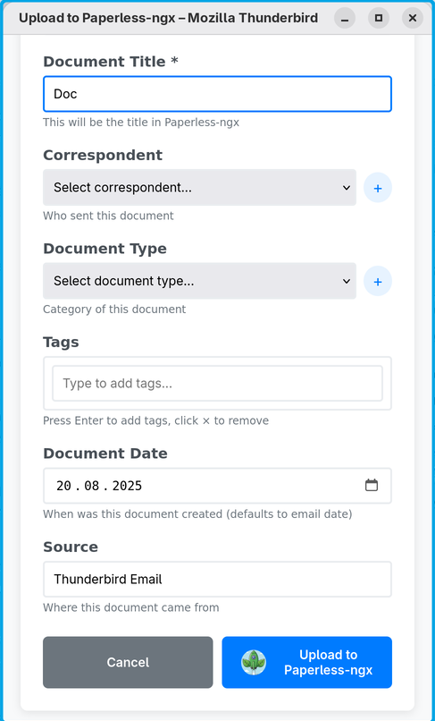
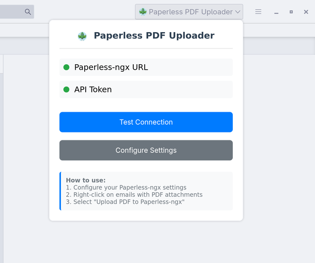
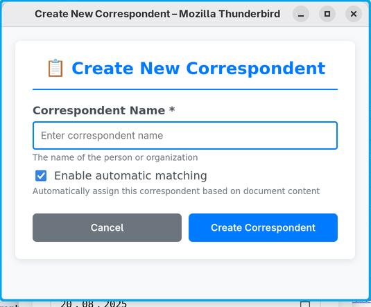
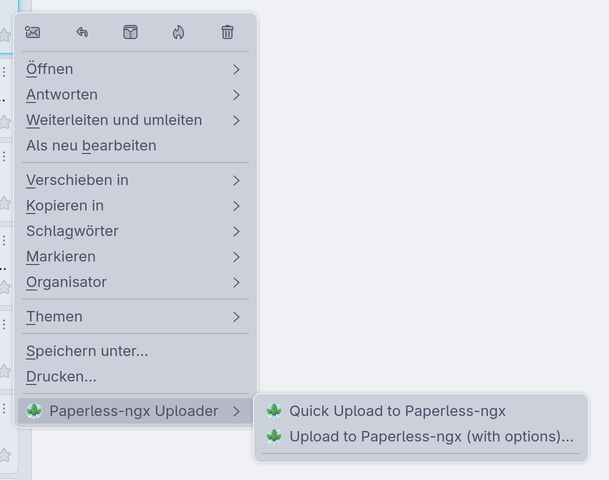
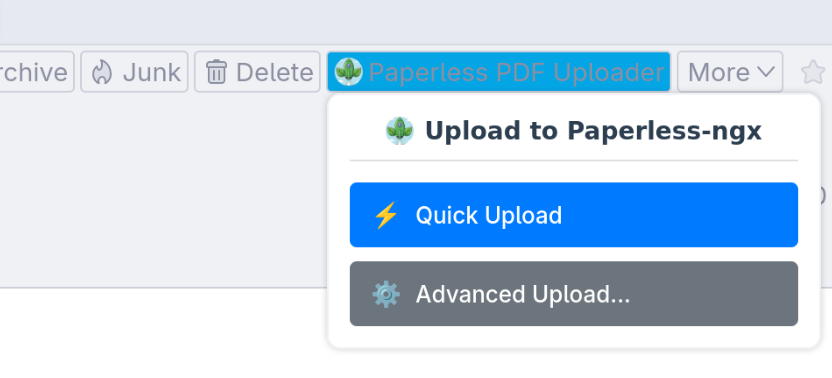

# Paperless Uploader for Thunderbird

<p align="center">
  
</p>

Available in the [Thunderbird Add-On Gallery](https://addons.thunderbird.net/addon/paperless-ngx-uploader/).


## Screenshots

<div align="center">
  <!-- First Row -->
  <table>
    <tr>
      <td align="center" valign="top">
        <h3>Settings Interface</h3>
        
      </td>
      <td align="center" valign="top">
        <h3>Advanced Upload Dialog</h3>
        
      </td>
    </tr>
  </table>
  
  <!-- Second Row -->
  <table>
    <tr>
      <td align="center" valign="top">
        <h3>Popup Interface</h3>
        
      </td>
      <td align="center" valign="top">
        <h3>Add Correspondent</h3>
        
      </td>
      <td align="center" valign="top">
        <h3>Context Menu Integration</h3>
        
      </td>
    </tr>
  </table>

  <!-- Third Row -->
  <table>
    <tr>
      <td align="center" valign="top">
        <h3>Message Context Interface</h3>
        
      </td>
    </tr>
  </table>
</div>

---

## Usage

1. Open an email with a PDF attachment.
2. Click the **Paperless Uploader** icon in the Thunderbird toolbar.
3. Configure your paperless-ngx server URL and API key in the add-on's options (first use only).
4. Right click the message and select the upload option.
5. Receive a notification when the upload is complete.


## Overview

**Paperless Uploader** is a Thunderbird add-on that streamlines the process of uploading PDF attachments directly to your [paperless-ngx](https://github.com/paperless-ngx/paperless-ngx) server. With a single click, you can send documents from your inbox to your document management system—no manual downloads or uploads required.

---

## Features

- Upload PDF attachments from any email directly to paperless-ngx
- Optionally also images, plain text and Office documents (Office/.eml require Tika on the server)
- Set title, correspondent, document type, tags and date before uploading, or create new correspondents and document types on the fly
- Simple configuration for your paperless-ngx instance via API Key
- Get notifications on upload success or failure
- Seamless integration with Thunderbird’s UI

---

## Installation
### Default
- Just search for the Add-On in Thunderbird and install it like any other.
### Manual
1. Download the latest release (`.xpi` file) from the [Releases](https://github.com/sebastian-xyz/paperless-upload-thunderbird/releases) page or build from source.
2. In Thunderbird, go to **Add-ons and Themes** > **Extensions** > **Install Add-on From File...**
3. Select the downloaded `.xpi` file and follow the prompts.

---

## Usage

1. Open an email with a PDF attachment.
2. Click the **Paperless Uploader** icon in the Thunderbird toolbar.
3. Configure your paperless-ngx server URL and API key in the add-on’s options (first use only).
4. Rigth click the message and select the upload option.
5. Receive a notification when the upload is complete.

---

## Configuration

Go to **Add-ons and Themes** > **Extensions** > **Paperless Uploader** > **Preferences** to set:

- **Server URL**: The base URL of your paperless-ngx instance
- **API Key**: Your personal API key for authentication
- **Default Tags** (optional): Comma-separated tag names, applied on quick upload and preselected in the upload dialog. The tags must already exist in paperless-ngx.
- **Also offer images, text and Office documents** (optional): By default only PDFs are offered. Office documents and `.eml` files require the Tika/Gotenberg integration of paperless-ngx.

---

## Development

1. Clone this repository:
   ```bash
   git clone https://github.com/sebastian-xyz/paperless-upload-thunderbird.git
   ```
2. Open the folder in VS Code or your preferred editor.
3. Make your changes and test the add-on in Thunderbird’s debug mode.

---

## Contributing

Contributions are welcome! Please open an issue or submit a pull request for bug fixes, features, or documentation improvements.

---

## License

This project is licensed under the MIT License. See the [LICENSE](LICENSE) file for details.
